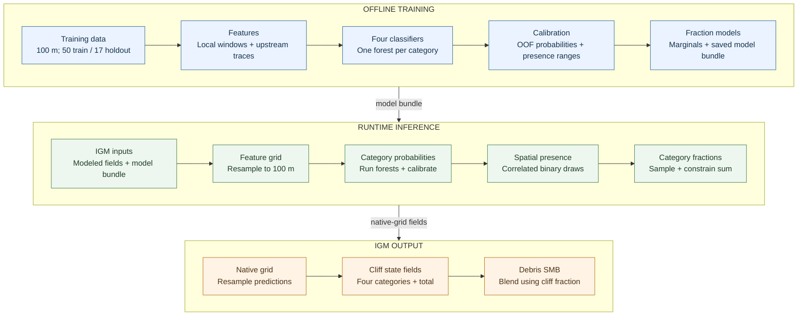

# Spatially Correlated Ice-Cliff Presence and Area-Fraction Prediction in IGM

**Author:** Method and IGM User-Process Implementation  
**Date:** 20 October 2026

## Contents

- [End-to-End Pipeline](#end-to-end-pipeline)
- [Purpose and Scope](#purpose-and-scope)
- [Training Data and Classifier](#training-data-and-classifier)
- [Spatially Correlated Presence](#spatially-correlated-presence)
- [Spatially Correlated Category Fractions](#spatially-correlated-category-fractions)
- [IGM Resolution and State Integration](#igm-resolution-and-state-integration)
- [Configuration](#configuration)
- [Validation and Limitations](#validation-and-limitations)

## End-to-End Pipeline

Default configuration: run 015, spatially stochastic presence, and fraction
rescaling. The legacy three-predictor model remains available by selecting its
bundle filename.

## Purpose and Scope

This document describes the cliff predictor installed in the IGM 3.2 user code at `user/code/processes/cliff_prediction.py`. It predicts four separate cliff categories on a debris-covered glacier grid:

1. stream-influenced,
2. pond-influenced,
3. crevasse-originated, and
4. undefined.

For each category, the method first predicts a presence probability, generates a spatially correlated binary presence field, and then samples a positive cell-area fraction for present cells. Category fractions are combined into a total cliff area fraction. The public array API can be called by other IGM modules; the `predict_from_state` adapter and the debris-SMB hook provide the current IGM integration.

The deployed default classifier is run 015: the 100 m, four-predictor, per-category presence random forests. The four predictors are `velocity_Millan2022`, `dStress`, `debris_thickness`, and `slope_rad`. The model and its parameters are stored in `user/code/processes/cliff_prediction_models.joblib` and `user/code/processes/cliff_prediction_parameters.json`.

Two additional classifier backends are available. Run 039 uses category-specific 50 m windows selected in run 037 and adds `elevation_AW3D` only to the pond model. Run 041 is the 100 m analogue, with upstream features for stream, pond, and undefined; crevasse remains window-only. Both bundles are installed in `user/code/processes/`. They reuse the default positive-fraction marginals and spatial covariance parameters, but have no backend-specific Platt calibrators, so probability calibration defaults off and must remain off unless matching calibrators are fitted.

## Training Data and Classifier

### Training target and domain

At training time, a category is present in a 100 m cell when its raw category area fraction is greater than $10^{-8}$. Training cells are debris-positive cells with finite category targets. Half of each eligible glacier's cells were sampled using the run-015 random seed. The glacier split held out 17 glaciers and trained on 50 glaciers. The held-out glaciers were not used for classifier fitting, probability calibration, or covariance estimation.

One binary random-forest classifier was fitted for each category. The run-015 parameters were 500 trees, minimum leaf size 5, maximum feature fraction 0.5, class-balanced bootstrap samples, and random seed 42. Missing features are imputed with training-set feature medians. The crevasse model uses only the window features; the other three category models also use upstream features.

### Predictor features

The training grid is 100 m. For each of the four predictors, the local window features comprise:

- the center value, 3 × 3 finite-neighbour mean, and 3 × 3 finite-neighbour standard deviation (12 values total);
- 11 × 11 finite-neighbour mean and standard deviation, excluding the center (8 more values).

The remaining 48 features summarize values along an upglacier trace: four statistics (mean, minimum, maximum, and trend) for each predictor at 200, 500, and 1000 m. The trend is the least-squares slope with distance, expressed per 100 m, and includes the center value. Thus the full vector has 68 features; the crevasse classifier selects 20 of them.

### Upglacier feature traces

When the training features were prepared, Millan velocity components defined the downstream direction. Traces move backward, upglacier, using a 50 m midpoint integration step. Velocity components are Gaussian-smoothed over about 100 m. Where speed is below 1 m yr$^{-1}$ or velocity is missing, direction falls back to the negative gradient of a surface-elevation field smoothed over about 150 m. Samples use bilinear interpolation and stop contributing when direction or predictor values are unavailable. In the IGM implementation, the direction is derived from modeled `uvelsurf` and `vvelsurf`, as specified for this application.

### Training probabilities

Let $p_{ic}^{\rm raw}$ be the random forest probability for cell $i$ and category $c$. This is the forest's estimated probability that the category is present, before calibration. The goal of calibration is to make probabilities more representative of observed frequencies. For example, among cells assigned a probability near 0.7, roughly 70% should be present if those probabilities are well calibrated. Calibration changes probability values, not the order of cells from lower to higher predicted probability.

The calibration data are generated separately for each category using five-fold `GroupKFold` cross-validation on the 50 training glaciers. In each fold, all sampled cells from some glaciers are held out together. A forest with the run-015 settings is refitted on the other folds and predicts probabilities for the held-out glaciers. Repeating this process gives every sampled training cell one out-of-fold (OOF) probability from a forest that did not train on that glacier. Holding out whole glaciers avoids letting nearby or otherwise related cells from the same glacier appear on both sides of a fold. These OOF probabilities are used to fit the calibrator; they are not the probabilities used directly at inference time. At inference, the saved calibrator is applied to the raw probabilities from the final run-015 forest.

A separate monotone Platt transform is fitted for each category:

$$
p_{ic}^{\rm cal} =
\operatorname{logit}^{-1}\!\left(a_c+b_c\operatorname{logit}
\left(\operatorname{clip}(p_{ic}^{\rm raw},10^{-5},1-10^{-5})\right)\right),
\qquad b_c>0.
$$

Clipping keeps probabilities of exactly zero or one away from infinite log-odds. The parameters are chosen by minimizing weighted binary log loss on the OOF predictions. Each cell receives a weight inversely proportional to the number of sampled cells from its glacier, so every glacier has the same total weight even if some glaciers contribute many more cells. A small penalty on the log-slope stabilizes the fit, and writing $b_c=\exp(\gamma_c)$ guarantees $b_c>0$.

The intercept $a_c$ shifts the logits up or down. The slope $b_c$ controls how strongly the raw logits are stretched: values below one pull probabilities toward 0.5, while values above one push them farther from 0.5, before the intercept shift. Because the slope is positive, the transform preserves the ranking of cells. The fitted run-015 parameters are:

| Category | $a_c$ (intercept) | $b_c$ (slope) |
|:--|--:|--:|
| Stream | -0.363762 | 0.789387 |
| Pond | -0.668262 | 1.063949 |
| Crevasse | -1.161831 | 0.656355 |
| Undefined | -0.575136 | 0.717679 |

These values are stored in the JSON parameter file. Calibrated probabilities are used for stochastic presence sampling and for the residuals used to fit spatial presence covariance. The deterministic threshold option instead uses the raw random-forest probability at the configured threshold, 0.5 by default, to preserve the original run-015 comparison.

## Spatially Correlated Presence

The classifier gives each 100 m cell a probability of containing a cliff of a given category. Drawing a separate yes/no result for every cell would treat nearby cells as unrelated and could produce a speckled map. This section adds spatial structure to those draws: nearby cells are more likely to have similar outcomes, while each cell keeps the probability predicted for it. The dependence is estimated separately for each cliff category.

### Training the presence covariance

To estimate how strongly presence tends to cluster, we compare the observed training labels with their calibrated probabilities. The calculation uses out-of-fold predictions, so each training cell's probability comes from a model that did not train on that cell's glacier. For category $c$ and cell $i$, the standardized residual is

$$
r_{ic}=\frac{y_{ic}-p_{ic}^{\rm cal}}
{\sqrt{p_{ic}^{\rm cal}(1-p_{ic}^{\rm cal})}},
$$

where $y_{ic}$ is 1 when the category is present and 0 otherwise. A positive residual means presence was observed more often than the probability predicted; a negative residual means it was observed less often. Dividing by the Bernoulli standard deviation makes errors at cells with different probabilities more comparable. Residuals are clipped to $[-6,6]$ to limit the influence of extreme values, then centered within each glacier to remove its average prediction error. They are put back at their sampled grid locations so that neighbouring cells can be compared.

For each category, correlations between residuals are grouped by their raster offset (the row and column separation between cells), up to 12 cells, or 1.2 km. Offsets with fewer than 40 cell pairs are left out because their correlation estimates would be based on too little data. A smooth, direction-independent model is then fitted to describe how correlation changes with distance:

$$
\rho_c(d)=\exp\!\left[-\frac{1}{2}
\left(\frac{d}{L_c^{\rm pres}}\right)^2\right].
$$

Here $d$ is the distance between cells and $L_c^{\rm pres}$ is the fitted correlation range. It is a characteristic distance, not a boundary beyond which correlation becomes zero: at $d=L_c^{\rm pres}$, the fitted correlation is about 0.61, and it declines smoothly with distance. The isotropic model assumes the same relationship in every direction. The fitted run-015 presence ranges are:

| Category | $L_c^{\rm pres}$ (m) |
|:--|--:|
| Stream | 78.4 |
| Pond | 81.3 |
| Crevasse | 152.2 |
| Undefined | 70.4 |

These ranges are around or below the 100 m grid spacing. They therefore describe dependence on the discrete grid, rather than a sharply defined physical patch size.

### Gaussian-copula sampling

For each glacier and category, the sampler starts with random noise and applies a spatial Gaussian filter. This produces a standard-normal field $Z_{ic}$ in which nearby values tend to be similar. The standard-normal cumulative distribution function $\Phi$ converts those values to a uniform field $U_{ic}=\Phi(Z_{ic})$. The conversion keeps the spatial ordering of the field but makes each cell's value uniformly distributed between zero and one. A presence draw is made by comparing that value with the cell's calibrated probability:

$$
Y_{ic}=\mathbb{1}\{U_{ic}<p_{ic}^{\rm cal}\}.
$$

For example, a cell with probability 0.7 is present when its uniform value is below 0.7. Because a uniform value falls below 0.7 in 70% of repeated draws, the cell's probability is preserved. Since nearby uniform values tend to be similar, nearby cells are also more likely to land on the same side of their probability thresholds. This makes presence spatially clustered without changing the probability assigned to each cell. It does not force neighbours to have the same outcome. Each category uses its own independent random field. Random seeds are derived from a base seed, glacier identifier, and category index, so the draws are reproducible.

The implementation uses a Gaussian filter on the discrete grid. Its smoothing width is chosen so that the correlation produced on the grid matches the fitted squared-exponential model. This calibration is important because the fitted ranges are near or below one 100 m cell: a continuous-space approximation alone would not describe the discrete filter accurately. The random field is generated on a padded grid and then cropped to the glacier grid. Padding prevents the filter from treating opposite edges of the array as neighbours.

## Spatially Correlated Category Fractions

### Fitted marginal distributions

Only positive 100 m category fractions from the 50 training glaciers are used to fit these distributions. Candidate families are fitted with a discretized likelihood that accounts approximately for the fraction-value lattice, and the family with lowest AIC is selected independently for each category:

| Category | Selected family | Parameters |
|:--|:--|:--|
| Stream | Two-component truncated exponential | logit weight $-0.8816$; rates $103.2776,15.0357$ |
| Pond | Two-component truncated exponential | logit weight $-0.7862$; rates $73.2004,16.5310$ |
| Crevasse | Truncated Kumaraswamy | $a=0.8452,\ b=5.8086$ |
| Undefined | Truncated generalized gamma | $a=5.8524,\ c=0.2899,\ \mathrm{scale}=4.6658\times10^{-5}$ |

All fitted distributions are supported on $(0,1]$. For a two-component truncated exponential, for example,

$$
F(x)=w\frac{1-e^{-\lambda_1x}}{1-e^{-\lambda_1}}
+(1-w)\frac{1-e^{-\lambda_2x}}{1-e^{-\lambda_2}},
\qquad w=\operatorname{logit}^{-1}(\eta),\quad 0<x\leq1.
$$

*Observed cumulative distributions of positive cliff fractions at 50 m and 100 m, with the best-AIC fitted distribution for each category and resolution. Dashed curves show fitted distributions; the dotted vertical line marks the $10^{-3}$ presence threshold. AIC is based on the discretized likelihood.*

### Training the magnitude covariance

Presence and fraction magnitude are modeled with separate spatial fields. The presence field decides which cells contain a category; the magnitude field decides how large its positive fraction is. Magnitude covariance is therefore estimated only from positive training fractions, separately for each category. Cells with zero fraction are excluded because they are modeled by the presence process, not by the positive-fraction distribution.

Raw fractions have strongly skewed, category-specific distributions. Estimating spatial correlation directly from them would mix two effects: the shape and scale of the fraction distribution, and the tendency for nearby cells to have similar relative magnitudes. To separate these, the positive values are ranked within each glacier and category. If a glacier has $n$ positive values and a value has rank $k$, its rank is converted to a normal score

$$
z_k=\Phi^{-1}\!\left(\frac{k-0.5}{n}\right),
$$

where $\Phi^{-1}$ is the standard-normal quantile function. Tied fractions receive their average rank. The scores are then centered and scaled to have mean zero and standard deviation one within that glacier. Ranking makes the score pattern depend on which cells have relatively small or large fractions, rather than on the category's particular units, skew, or range. Doing this separately by glacier also prevents glaciers with systematically larger fractions from setting the spatial relationship for the others.

The scores are placed back at their original 100 m raster cells; cells without a positive target remain missing. For every raster offset up to 12 cells (1.2 km), the method collects pairs of finite scores at that offset from all training glaciers. Offsets are pooled into distance bins rounded to 0.1 cell, including different directions; bins with fewer than 30 pairs are discarded. This pooling treats spatial dependence as isotropic. The empirical correlation for each distance is the normalized sum of products of the paired, within-glacier standardized scores. Thus each qualifying cell pair contributes to the estimate, and well-sampled distances are given more influence in the fit.

The empirical correlations are fitted to the isotropic squared-exponential model

$$
\rho_c(d)=\exp\!\left[-\frac{1}{2}\left(\frac{d}{L_c^{\rm mag}}\right)^2\right],
$$

where $d$ is separation and $L_c^{\rm mag}$ is the category-specific magnitude correlation range. The fit minimizes a weighted squared error between empirical and modeled correlations; the weight is the square root of the number of pairs at that distance. This single range is a compact approximation to the observed correlogram, not a correlation cutoff: at $d=L_c^{\rm mag}$, the modeled correlation is about 0.61, and it decays smoothly with distance. Because the model is isotropic, it does not represent flow-aligned or other directional structure. The fitted run-015 magnitude ranges are:

| Category | $L_c^{\rm mag}$ (m) |
|:--|--:|
| Stream | 60.3 |
| Pond | 45.6 |
| Crevasse | 53.8 |
| Undefined | 52.5 |

These ranges describe dependence in the normal-score ranks of positive fractions. They are not ranges fitted to raw fractions, and they should not be read as the diameter of a typical cliff patch. All are below the 100 m cell spacing, so their practical meaning is the strength of dependence on the discrete grid, particularly between nearby cells; the exact relationship is affected by the raster-lattice filter used during sampling.

### Sampling magnitudes

Sampling combines the presence decision, the fitted magnitude covariance, and the fitted positive-fraction distribution in sequence. First, the presence process described above determines the binary indicator $Y_{ic}$ for each cell and category. It uses the classifier's cell-specific probability, with spatial dependence supplied by the separate presence field. The magnitude step does not change this decision: it assigns a size only after presence has been determined.

For each glacier and category, a new Gaussian field $G_{ic}$ is generated independently of the presence field and of the other categories' magnitude fields. Its spatial correlation uses the category-specific magnitude range estimated above. When fraction spatial correlation is enabled, the discrete Gaussian filter is calibrated to approximate that range on the 100 m grid; when it is disabled, the cells receive independent Gaussian values. The field is sampled at the debris-positive cell locations being predicted.

Applying the standard-normal CDF gives $V_{ic}=\Phi(G_{ic})$, uniform values between zero and one. These values act as percentiles in the fitted category-specific positive-fraction distribution $F_c$. Thus

$$
f_{ic}=F_c^{-1}(V_{ic});
\qquad f_{ic}=0\quad\text{when }Y_{ic}=0.
$$

The rank transformation used during training estimates only the spatial dependence; it does not supply or resample the fraction values at runtime. Instead, the inverse CDF turns each simulated percentile into a new fraction. Because both transformations preserve order, nearby correlated Gaussian values tend to produce nearby percentiles and hence similar fraction ranks, while the inverse CDF restores the category's fitted, generally skewed fraction distribution. Before the total-fraction constraint below, the positive draws therefore follow $F_c$ marginally, while their spatial ranks are correlated. Fraction magnitude is not forced to increase with presence probability because the presence and magnitude fields are generated independently.

The four categories are sampled independently, so more than one can be present in a cell. Their fractions are then checked jointly. If the sum exceeds one, the default `rescale` policy divides each category fraction in that cell by the sum, preserving which categories are present and making the total equal to one. This necessary constraint changes the sampled magnitudes in overfull cells, so their final marginal distributions are no longer exactly $F_c$. The `allow` policy leaves overfull sums unchanged; `error` raises an exception instead.

## IGM Resolution and State Integration

The selected backend determines the model grid: run 039 uses 50 m, while run 015, run 016, and run 041 use 100 m. The IGM state adapter therefore:

1. Resamples predictor grids, modeled velocity components, surface elevation, and mask to the selected backend's feature grid.
2. Computes that backend's category-specific windows and upstream features, then runs the classifier and sampler at its model resolution.
3. Resamples probabilities and category fractions back to the IGM grid. Probabilities use bilinear interpolation when upsampling. Fractions use nearest-neighbor when upsampling. Downsampling uses subcell area sampling for each output. Presence is nearest-neighbor when upsampling and set present when any contributing model-grid cell is present when downsampling.

When `require_100m_grid` is enabled, direct array calls require the selected backend's model resolution; the state adapter resamples automatically. Its default predictor velocity is $\sqrt{u_{\rm surf}^2+v_{\rm surf}^2}$ from modeled `uvelsurf`/`vvelsurf`. Driving stress defaults to `state.dStress`, then `state.tau_d`, then $\rho gH\sin(\alpha)$ with 3 × 3 averaging. Upstream direction uses the same modeled velocity components; low or missing speed uses the negative surface gradient. Grid-axis signs convert map velocity into array row/column directions.

Runs 039 and 041 were trained with observed `elevation_AW3D` for the pond category. At inference, the state adapter uses `state.elevation_AW3D` if present, otherwise modeled `state.usurf` as a proxy; callers of the direct array API can supply `predictors["elevation_AW3D"]` or pass `surface_elevation`. This observed-to-modeled elevation substitution requires validation for the intended application.

The existing debris-SMB hook calls the predictor when `processes.debris_cover.smb.cliffs` is true. It writes the four category fractions to `state.cliffs_s`, `cliffs_p`, `cliffs_c`, and `cliffs_u`, and their sum to `state.cliffs_total`. The SMB adjustment then uses

$$
\mathrm{SMB}_{\rm out}=\mathrm{SMB}_{\rm debris}(1-f_{\rm cliff})
+\mathrm{SMB}_{\rm clean}f_{\rm cliff}\,E_{\rm cliff},
$$

where $f_{\rm cliff}$ is the predicted total area fraction and $E_{\rm cliff}$ is `cliff_smb_enhancement`. The old three-predictor regressor can be selected by setting `model_file` to `cliff_type_models.joblib`.

## Configuration

Configuration is nested under `processes.debris_cover.smb.cliff_prediction` in `user/conf/processes/debris_cover.yaml`. Important choices are:

- **`model_file`**: Selects the serialized model bundle: `cliff_prediction_models.joblib` (default run015), `cliff_prediction_models_run016.joblib`, `cliff_prediction_models_run039.joblib` (50 m), `cliff_prediction_models_run041.joblib` (100 m), or `cliff_type_models.joblib` (legacy three-predictor model). The bundle supplies the model grid and feature schema.
- **`presence_mode`**: `spatial_stochastic` (default), `independent_stochastic`, or `threshold`.
- **`probability_calibration`**: Toggle training-only Platt calibration for stochastic presence. It defaults off for run039/run041 because no calibrators were fitted for those classifiers; enabling it for those backends raises an error.
- **`presence_spatial_correlation`**: Toggle spatial correlation in the presence field.
- **`fraction_spatial_correlation`**: Toggle spatial correlation in magnitude fields.
- **`fraction_sum_policy`**: `rescale`, `allow`, or `error` for category sums above one.
- **`allow_surface_slope_fallback`**: Allow surface descent when modeled velocity is missing or slow.
- **`window_policy`**: `physical` approximates 300 m/1100 m windows off-grid; `fixed_cells` keeps 3 × 3 and 11 × 11.
- **`require_100m_grid`**: Applies to direct array calls and requires the selected backend's model grid. The IGM state adapter resamples to that grid automatically.
- **`random_seed`**: Base seed for reproducible spatial fields.

## Validation and Limitations

The implementation was smoke-tested under the igm-3.2 environment on synthetic 50, 100, and 200 m IGM grids, including the debris-SMB call path. Feature vectors were compared to the run-015 training extractor on sampled glacier cells: the finite-value pattern matched; remaining numerical differences were small relative to feature scales. A full glacier run should still be checked before scientific deployment.

The current classifier was trained with Millan2022 observed velocity but the IGM adapter uses modeled velocity, as requested. This predictor substitution can shift the model distribution and should be validated against mapped cliffs. Other limitations include isotropic covariance despite flow-aligned glacier geometry, covariance ranges estimated from a limited training sample, the single-realization variability of stochastic output, and changes to category marginals if the total-fraction rescaling policy is triggered.
