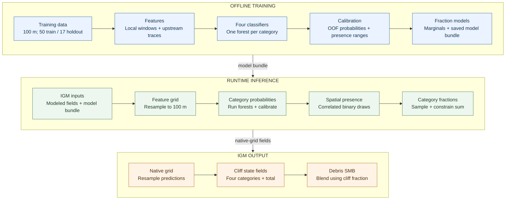

# Spatially Correlated Ice-Cliff Presence and Area-Fraction Prediction in IGM

**Author:** Method and IGM User-Process Implementation  
**Date:** 20 October 2026

## Contents

- [End-to-End Pipeline](#end-to-end-pipeline)
- [Purpose and Scope](#purpose-and-scope)
- [Training Data and Classifier](#training-data-and-classifier)
- [Spatially Correlated Presence](#spatially-correlated-presence)
- [Spatially Correlated Category Fractions](#spatially-correlated-category-fractions)
- [IGM Resolution and State Integration](#igm-resolution-and-state-integration)
- [Configuration](#configuration)
- [Validation and Limitations](#validation-and-limitations)

## End-to-End Pipeline

Default configuration: run 015, spatially stochastic presence, and fraction
rescaling. The legacy three-predictor backend remains available.

## Purpose and Scope

This document describes the cliff predictor installed in the IGM 3.2 user code at `user/code/processes/cliff_prediction.py`. It predicts four separate cliff categories on a debris-covered glacier grid:

1. stream-influenced,
2. pond-influenced,
3. crevasse-originated, and
4. undefined.

For each category, the method first predicts a presence probability, generates a spatially correlated binary presence field, and then samples a positive cell-area fraction for present cells. Category fractions are combined into a total cliff area fraction. The public array API can be called by other IGM modules; the `predict_from_state` adapter and the debris-SMB hook provide the current IGM integration.

The deployed classifier is run 015: the 100 m, four-predictor, per-category presence random forests. The four predictors are `velocity_Millan2022`, `dStress`, `debris_thickness`, and `slope_rad`. The model and its parameters are stored in `user/code/processes/cliff_prediction_models.joblib` and `user/code/processes/cliff_prediction_parameters.json`.

## Training Data and Classifier

### Training target and domain

At training time, a category is present in a 100 m cell when its raw category area fraction is greater than $10^{-8}$. Training cells are debris-positive cells with finite category targets. Half of each eligible glacier's cells were sampled using the run-015 random seed. The glacier split held out 17 glaciers and trained on 50 glaciers. The held-out glaciers were not used for classifier fitting, probability calibration, or covariance estimation.

One binary random-forest classifier was fitted for each category. The run-015 parameters were 500 trees, minimum leaf size 5, maximum feature fraction 0.5, class-balanced bootstrap samples, and random seed 42. Missing features are imputed with training-set feature medians. The crevasse model uses only the window features; the other three category models also use upstream features.

### Predictor features

The training grid is 100 m. For each of the four predictors, the local window features comprise:

- the center value, 3 × 3 finite-neighbour mean, and 3 × 3 finite-neighbour standard deviation (12 values total);
- 11 × 11 finite-neighbour mean and standard deviation, excluding the center (8 more values).

The remaining 48 features summarize values along an upglacier trace: four statistics (mean, minimum, maximum, and trend) for each predictor at 200, 500, and 1000 m. The trend is the least-squares slope with distance, expressed per 100 m, and includes the center value. Thus the full vector has 68 features; the crevasse classifier selects 20 of them.

### Upglacier feature traces

When the training features were prepared, Millan velocity components defined the downstream direction. Traces move backward, upglacier, using a 50 m midpoint integration step. Velocity components are Gaussian-smoothed over about 100 m. Where speed is below 1 m yr$^{-1}$ or velocity is missing, direction falls back to the negative gradient of a surface-elevation field smoothed over about 150 m. Samples use bilinear interpolation and stop contributing when direction or predictor values are unavailable. In the IGM implementation, the direction is derived from modeled `uvelsurf` and `vvelsurf`, as specified for this application.

### Training probabilities

Let $p_{ic}^{\rm raw}$ be the random forest probability for cell $i$ and category $c$. Calibration uses five-fold `GroupKFold` out-of-fold predictions on the 50 training glaciers, with each glacier receiving equal total weight. A monotone Platt transform is fitted separately for each category:

$$
p_{ic}^{\rm cal} =
\operatorname{logit}^{-1}\!\left(a_c+b_c\operatorname{logit}
\left(\operatorname{clip}(p_{ic}^{\rm raw},\epsilon,1-\epsilon)\right)\right),
\qquad b_c>0.
$$

The fitted intercepts and slopes are in the JSON parameter file. Probability calibration affects the stochastic mode. The deterministic threshold option uses the raw random-forest probability at the configured threshold, 0.5 by default, to preserve the original run-015 comparison.

## Spatially Correlated Presence

The classifier gives each 100 m cell a probability of containing a cliff of a given category. Drawing a separate yes/no result for every cell would treat nearby cells as unrelated and could produce a speckled map. This section adds spatial structure to those draws: nearby cells are more likely to have similar outcomes, while each cell keeps the probability predicted for it. The dependence is estimated separately for each cliff category.

### Training the presence covariance

To estimate how strongly presence tends to cluster, we compare the observed training labels with their calibrated probabilities. The calculation uses out-of-fold predictions, so each training cell's probability comes from a model that did not train on that cell's glacier. For category $c$ and cell $i$, the standardized residual is

$$
r_{ic}=\frac{y_{ic}-p_{ic}^{\rm cal}}
{\sqrt{p_{ic}^{\rm cal}(1-p_{ic}^{\rm cal})}},
$$

where $y_{ic}$ is 1 when the category is present and 0 otherwise. A positive residual means presence was observed more often than the probability predicted; a negative residual means it was observed less often. Dividing by the Bernoulli standard deviation makes errors at cells with different probabilities more comparable. Residuals are clipped to $[-6,6]$ to limit the influence of extreme values, then centered within each glacier to remove its average prediction error. They are put back at their sampled grid locations so that neighbouring cells can be compared.

For each category, correlations between residuals are grouped by their raster offset (the row and column separation between cells), up to 12 cells, or 1.2 km. Offsets with fewer than 40 cell pairs are left out because their correlation estimates would be based on too little data. A smooth, direction-independent model is then fitted to describe how correlation changes with distance:

$$
\rho_c(d)=\exp\!\left[-\frac{1}{2}
\left(\frac{d}{L_c^{\rm pres}}\right)^2\right].
$$

Here $d$ is the distance between cells and $L_c^{\rm pres}$ is the fitted correlation range. It is a characteristic distance, not a boundary beyond which correlation becomes zero: at $d=L_c^{\rm pres}$, the fitted correlation is about 0.61, and it declines smoothly with distance. The isotropic model assumes the same relationship in every direction. The fitted run-015 presence ranges are:

| Category | $L_c^{\rm pres}$ (m) |
|:--|--:|
| Stream | 78.4 |
| Pond | 81.3 |
| Crevasse | 152.2 |
| Undefined | 70.4 |

These ranges are around or below the 100 m grid spacing. They therefore describe dependence on the discrete grid, rather than a sharply defined physical patch size.

### Gaussian-copula sampling

For each glacier and category, the sampler starts with random noise and applies a spatial Gaussian filter. This produces a standard-normal field $Z_{ic}$ in which nearby values tend to be similar. The standard-normal cumulative distribution function $\Phi$ converts those values to a uniform field $U_{ic}=\Phi(Z_{ic})$. The conversion keeps the spatial ordering of the field but makes each cell's value uniformly distributed between zero and one. A presence draw is made by comparing that value with the cell's calibrated probability:

$$
Y_{ic}=\mathbb{1}\{U_{ic}<p_{ic}^{\rm cal}\}.
$$

For example, a cell with probability 0.7 is present when its uniform value is below 0.7. Because a uniform value falls below 0.7 in 70% of repeated draws, the cell's probability is preserved. Since nearby uniform values tend to be similar, nearby cells are also more likely to land on the same side of their probability thresholds. This makes presence spatially clustered without changing the probability assigned to each cell. It does not force neighbours to have the same outcome. Each category uses its own independent random field. Random seeds are derived from a base seed, glacier identifier, and category index, so the draws are reproducible.

The implementation uses a Gaussian filter on the discrete grid. Its smoothing width is chosen so that the correlation produced on the grid matches the fitted squared-exponential model. This calibration is important because the fitted ranges are near or below one 100 m cell: a continuous-space approximation alone would not describe the discrete filter accurately. The random field is generated on a padded grid and then cropped to the glacier grid. Padding prevents the filter from treating opposite edges of the array as neighbours.

## Spatially Correlated Category Fractions

### Fitted marginal distributions

Only positive 100 m category fractions from the 50 training glaciers are used to fit these distributions. Candidate families are fitted with a discretized likelihood that accounts approximately for the fraction-value lattice, and the family with lowest AIC is selected independently for each category:

| Category | Selected family | Parameters |
|:--|:--|:--|
| Stream | Two-component truncated exponential | logit weight $-0.8816$; rates $103.2776,15.0357$ |
| Pond | Two-component truncated exponential | logit weight $-0.7862$; rates $73.2004,16.5310$ |
| Crevasse | Truncated Kumaraswamy | $a=0.8452,\ b=5.8086$ |
| Undefined | Truncated generalized gamma | $a=5.8524,\ c=0.2899,\ \mathrm{scale}=4.6658\times10^{-5}$ |

All fitted distributions are supported on $(0,1]$. For a two-component truncated exponential, for example,

$$
F(x)=w\frac{1-e^{-\lambda_1x}}{1-e^{-\lambda_1}}
+(1-w)\frac{1-e^{-\lambda_2x}}{1-e^{-\lambda_2}},
\qquad w=\operatorname{logit}^{-1}(\eta),\quad 0<x\leq1.
$$

### Training the magnitude covariance

Presence and fraction magnitude are modeled with separate spatial fields. To estimate magnitude dependence, positive fraction values are ranked separately within each training glacier and category; the ranks are converted to normal scores. This removes the marginal distribution shape before estimating spatial dependence. Normal-score pair correlations are pooled by raster offset up to 12 cells, requiring at least 30 pairs per offset, then fitted with the same squared-exponential form. The fitted magnitude ranges are:

| Category | $L_c^{\rm mag}$ (m) |
|:--|--:|
| Stream | 60.3 |
| Pond | 45.6 |
| Crevasse | 53.8 |
| Undefined | 52.5 |

### Sampling magnitudes

An independent category-specific Gaussian field $G_{ic}$ is converted to $V_{ic}=\Phi(G_{ic})$. For cells with $Y_{ic}=1$, the area fraction is

$$
f_{ic}=F_c^{-1}(V_{ic});
\qquad f_{ic}=0\quad\text{when }Y_{ic}=0.
$$

Thus spatial ranks of positive fractions are correlated, while their marginal distribution follows the fitted category CDF. Magnitude fields are independent of the presence fields, so fraction size is not forced to increase with presence probability. The discrete filter width is calibrated on the 100 m lattice in the same way as for presence.

Category models are independent and can produce multiple categories per cell. If their sampled fractions sum above one, the default `rescale` policy divides all four category fractions by their sum, preserving presence while constraining total cliff area to the cell area. Alternatives are `allow` (leave the sum unchanged) and `error` (raise an exception).

## IGM Resolution and State Integration

The classifier is trained at 100 m. The IGM state adapter therefore:

1. Resamples the four predictor grids, modeled velocity components, surface elevation, and mask to a 100 m feature grid.
2. Computes local and upstream features and runs the classifier and sampler at 100 m.
3. Resamples raw/calibrated probabilities and category fractions back to the IGM grid. Probabilities use bilinear interpolation when upsampling. Fractions use nearest-neighbor when upsampling. Downsampling uses subcell area sampling for each output. Presence is nearest-neighbor when upsampling and set present when any contributing 100 m cell is present when downsampling.

The default run configuration requires 100 m for direct array calls. The IGM state adapter automatically performs the conversion when `state.dx` differs from 100 m. Its default predictor velocity is $\sqrt{u_{\rm surf}^2+v_{\rm surf}^2}$ from modeled `uvelsurf`/`vvelsurf`. Driving stress defaults to `state.dStress`, then `state.tau_d`, then $\rho gH\sin(\alpha)$ with 3 × 3 averaging. Upstream direction uses the same modeled velocity components; low or missing speed uses the negative surface gradient. Grid-axis signs convert map velocity into array row/column directions.

The existing debris-SMB hook calls the predictor when `processes.debris_cover.smb.cliffs` is true. It writes the four category fractions to `state.cliffs_s`, `cliffs_p`, `cliffs_c`, and `cliffs_u`, and their sum to `state.cliffs_total`. The SMB adjustment then uses

$$
\mathrm{SMB}_{\rm out}=\mathrm{SMB}_{\rm debris}(1-f_{\rm cliff})
+\mathrm{SMB}_{\rm clean}f_{\rm cliff}\,E_{\rm cliff},
$$

where $f_{\rm cliff}$ is the predicted total area fraction and $E_{\rm cliff}$ is `cliff_smb_enhancement`. The old three-predictor regressor is retained behind the `legacy_three_predictor` backend.

## Configuration

Configuration is nested under `processes.debris_cover.smb.cliff_prediction` in `user/conf/processes/debris_cover.yaml`. Important choices are:

- **`backend`**: `run015` (default) or `legacy_three_predictor`.
- **`presence_mode`**: `spatial_stochastic` (default), `independent_stochastic`, or `threshold`.
- **`probability_calibration`**: Toggle training-only Platt calibration for stochastic presence.
- **`presence_spatial_correlation`**: Toggle spatial correlation in the presence field.
- **`fraction_spatial_correlation`**: Toggle spatial correlation in magnitude fields.
- **`fraction_sum_policy`**: `rescale`, `allow`, or `error` for category sums above one.
- **`allow_surface_slope_fallback`**: Allow surface descent when modeled velocity is missing or slow.
- **`window_policy`**: `physical` approximates 300 m/1100 m windows off-grid; `fixed_cells` keeps 3 × 3 and 11 × 11.
- **`require_100m_grid`**: Applies to the direct array API; the IGM state adapter resamples to 100 m regardless.
- **`random_seed`**: Base seed for reproducible spatial fields.

## Validation and Limitations

The implementation was smoke-tested under the igm-3.2 environment on synthetic 50, 100, and 200 m IGM grids, including the debris-SMB call path. Feature vectors were compared to the run-015 training extractor on sampled glacier cells: the finite-value pattern matched; remaining numerical differences were small relative to feature scales. A full glacier run should still be checked before scientific deployment.

The current classifier was trained with Millan2022 observed velocity but the IGM adapter uses modeled velocity, as requested. This predictor substitution can shift the model distribution and should be validated against mapped cliffs. Other limitations include isotropic covariance despite flow-aligned glacier geometry, covariance ranges estimated from a limited training sample, the single-realization variability of stochastic output, and changes to category marginals if the total-fraction rescaling policy is triggered.
